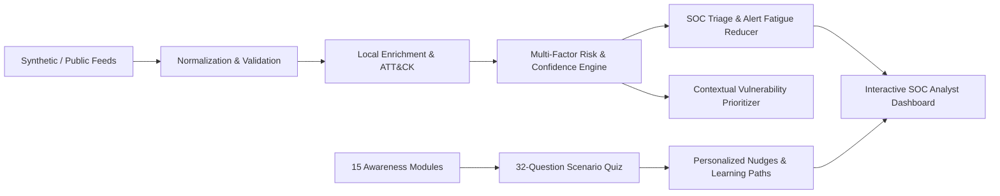
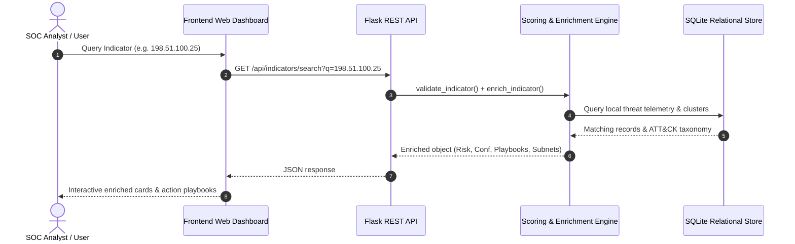

# 🛡️ Cybersecurity Awareness & Threat Intelligence Dashboard

[](#)
[](#)
[](#)
[](#)
[](#)
[](#)

A unified **Defensive Cyber Threat Intelligence (CTI) & Security Awareness Platform** that ingests, normalizes, validates, enriches, scores, and correlates threat indicators (IOCs, CVEs, campaigns) while delivering interactive micro-learning modules and security assessments to defend modern enterprise ecosystems.

---

## 📌 Table of Contents

- [Overview & Industry Relevance](#-overview--industry-relevance)
- [Key Features](#-key-features)
- [System Architecture & Data Flow](#-system-architecture--data-flow)
- [Threat Intelligence vs. Cybersecurity Awareness](#-threat-intelligence-vs-cybersecurity-awareness)
- [IOC Lifecycle & Validation Engine](#-ioc-lifecycle--validation-engine)
- [Multi-Factor Risk & Confidence Scoring](#-multi-factor-risk--confidence-scoring)
- [MITRE ATT&CK Behavioral Mapping](#-mitre-attck-behavioral-mapping)
- [Contextual Vulnerability Prioritization](#-contextual-vulnerability-prioritization)
- [Security Awareness & Assessment Center](#-security-awareness--assessment-center)
- [Technology Stack](#-technology-stack)
- [Project Folder Structure](#-project-folder-structure)
- [Installation & Local Execution](#-installation--local-execution)
- [Automated Testing Strategy](#-automated-testing-strategy)
- [REST API Reference](#-rest-api-reference)
- [Security & Ethical Considerations](#-security--ethical-considerations)
- [Author & License](#-author--license)

---

## 🚀 Overview & Industry Relevance

Modern Security Operations Centers (SOCs) and IT organizations face two compounding challenges:
1. **Threat Intelligence Overload & Alert Fatigue**: Disparate threat feeds and indicators of compromise (IOCs) lack context, leading to missed detections and operational paralysis.
2. **Human Defense Vulnerability**: Over 80% of enterprise intrusions start with a human element (phishing, credential re-use, social engineering).

This project bridges **Technical Threat Intelligence** and **Human Defense Hygiene** into a single cohesive, production-grade dashboard:



---

## ✨ Key Features

- **2,200+ Safe Synthetic Threat Dataset**: Fully compliant with RFC 5737 (192.0.2.0/24, 198.51.100.0/24, 203.0.113.0/24), RFC 3849 (2001:db8::/32), and reserved domains (`example.com`, `example.org`, `.invalid`).
- **Strict Syntactic IOC Validator**: Validates IPv4, IPv6, FQDNs, URLs, MD5/SHA-1/SHA-256 hashes, and CVE identifiers with format notes.
- **Offline Threat Enrichment Engine**: Adds threat category context, first-seen/last-seen timestamps, related indicator clusters, MITRE ATT&CK techniques, and defensive playbooks without making external network calls.
- **Multi-Factor Risk Scoring Engine (0–100)**:
  - 30% Severity + 25% Confidence + 15% Recency + 10% Frequency + 10% Reliability + 10% Context.
- **Clear Separation of Risk vs. Confidence**: Prevents low-confidence rumors from being treated as confirmed critical incidents.
- **Alert Fatigue Reduction & Clustering**: Automatically aggregates repeated indicator sightings into single contextual alerts.
- **Contextual Vulnerability Prioritizer**: Combines CVSS score, EPSS probability, CISA KEV exploitation signals, and asset exposure to prioritize patching.
- **Human Awareness Center**: 15 comprehensive micro-learning modules (Phishing, Passwords, MFA, Ransomware, Wi-Fi, Removable Media, Cloud Tokens, AI Scams).
- **Interactive 32-Question Scenario Quiz**: Real-time evaluation, category breakdown, and personalized learning recommendations.
- **Executive C-Level Summary**: High-level posture health briefing and strategic defensive priorities.

---

## 🏛️ System Architecture & Data Flow



---

## 🔬 Multi-Factor Risk & Confidence Scoring

### Risk Score Formulation
The composite risk score ($R \in [0, 100]$) assesses operational urgency:
$$R = 0.30 \cdot S_{\text{sev}} + 0.25 \cdot C_{\text{conf}} + 0.15 \cdot R_{\text{recency}} + 0.10 \cdot F_{\text{freq}} + 0.10 \cdot S_{\text{rel}} + 0.10 \cdot C_{\text{context}}$$

### Risk vs. Confidence Distinction
| Metric | Definition | Example Scenario |
| :--- | :--- | :--- |
| **Risk Score** | Potential severity and threat impact if verified | A zero-day rumor has Risk = 90 |
| **Confidence Score** | Evidentiary backing and source reliability | Unverified third-party rumor has Confidence = 25% |

---

## 🛠️ Technology Stack

- **Backend**: Python 3.10+, Flask REST API, SQLite3, Pandas
- **Frontend**: Responsive HTML5, Modern Dark Cyber CSS, Vanilla JavaScript, Chart.js
- **Testing**: Pytest (37 automated unit and integration tests)
- **Security Protocols**: RFC 5737, RFC 3849, RFC 2606 safe documentation standards

---

## 📁 Project Folder Structure

```text
cybersecurity-threat-intelligence-dashboard/
├── backend/
│   ├── app.py                      # REST API endpoints & static server
│   ├── database.py                 # SQLite schema, indexing & seeding
│   └── services/
│       ├── alert_engine.py         # Alert generation & fatigue deduplication
│       ├── attack_mapper.py        # MITRE ATT&CK taxonomy & mappings
│       ├── awareness_engine.py     # Quiz scoring & personalized recommendations
│       ├── correlation_engine.py   # Campaign clustering & related indicators
│       ├── enrichment_engine.py    # Local offline enrichment & playbooks
│       ├── ioc_validator.py        # Syntactic format validator (IP, Hash, CVE)
│       ├── risk_engine.py          # Multi-factor risk & confidence scoring
│       └── vulnerability_engine.py # Contextual CVSS/EPSS/KEV prioritization
├── frontend/
│   ├── index.html                  # Single-page SOC & Awareness dashboard
│   ├── css/
│   │   └── style.css               # SOC dark cyber aesthetic & components
│   └── js/
│       └── app.js                  # Chart.js visualizers, REST integration
├── awareness/
│   ├── modules.json                # 15 security awareness micro-modules
│   └── quiz_questions.json         # 32 scenario-based defensive questions
├── data/
│   ├── generate_threat_data.py     # Synthetic dataset generator (2,200+ records)
│   ├── threat_intelligence_dataset.csv
│   └── vulnerabilities.csv
├── tests/
│   └── test_suite.py               # 37 automated unit & integration tests
├── reports/
│   └── PROJECT_REPORT.md           # Formal academic & industry report
├── docs/
│   ├── ARCHITECTURE.md
│   ├── INTERVIEW_QA.md             # 10 interview questions & model answers
│   ├── RESUME_LINKEDIN.md          # Resume bullets, elevator pitch & LinkedIn post
│   └── SCREENSHOTS.md              # Screenshot checklist & asset filenames
├── requirements.txt
├── .env.example
├── .gitignore
└── README.md
```

---

## ⚡ Installation & Local Execution

### Step 1: Clone Repository
```bash
git clone https://github.com/your-username/Cybersecurity-Awareness-Threat-Intelligence-Dashboard.git
cd Cybersecurity-Awareness-Threat-Intelligence-Dashboard
```

### Step 2: Create & Activate Virtual Environment
```bash
python -m venv venv
# Windows:
.\venv\Scripts\activate
# Linux/macOS:
source venv/bin/activate
```

### Step 3: Install Dependencies
```bash
pip install -r requirements.txt
```

### Step 4: Generate Synthetic Datasets
```bash
python data/generate_threat_data.py
```

### Step 5: Initialize SQLite Database
```bash
python backend/database.py
```

### Step 6: Start Dashboard Server
```bash
python backend/app.py
```

### Step 7: Open in Browser
Open `http://127.0.0.1:5000` in your web browser.

---

## 🧪 Automated Testing Strategy

Run the complete 37-test automated verification suite:

```bash
python -m pytest tests/test_suite.py -v
```

### Test Coverage Highlights:
- Syntactic Validation for IPv4, IPv6, Domains, URLs, MD5, SHA-1, SHA-256, CVEs
- Risk Score Calculation Weighting & Tiers
- Alert Fatigue Deduplication and Observation Summation
- MITRE ATT&CK Taxonomy Mapping
- Risk-Based Vulnerability Prioritization
- Awareness Quiz Evaluation & Module Recommendation Engine
- REST API Status Codes and JSON Schemas

---

## 🌐 REST API Reference

| Method | Endpoint | Description |
| :--- | :--- | :--- |
| `GET` | `/api/dashboard/stats` | High-level KPI metrics & counts |
| `GET` | `/api/dashboard/trends` | Breakdown charts (Severity, Category, Tactics) |
| `GET` | `/api/threats` | Paginated threat feed with filters and sorting |
| `GET` | `/api/threats/<id>` | Full threat detail, enrichment, and notes |
| `POST` | `/api/threats` | Create new threat observation with auto-scoring |
| `GET` | `/api/indicators/search?q=...` | Instant IOC format validation and enrichment |
| `GET` | `/api/alerts` | Correlated SOC alert queue |
| `PUT` | `/api/alerts/<id>/status` | Update alert status (`INVESTIGATING`, `RESOLVED`) |
| `POST` | `/api/threats/<id>/notes` | Add analyst investigation note |
| `GET` | `/api/vulnerabilities` | Vulnerability list with calculated priority scores |
| `POST` | `/api/vulnerabilities/prioritize`| Interactive contextual priority calculator |
| `GET` | `/api/awareness/modules` | 15 security awareness micro-learning modules |
| `GET` | `/api/quiz` | 32 scenario quiz questions |
| `POST` | `/api/quiz/submit` | Evaluate quiz and generate recommendations |
| `GET` | `/api/executive/summary` | C-level cyber posture briefing |

---

## 🛡️ Security & Ethical Considerations

> [!IMPORTANT]
> **Ethical & Defensive Disclaimer**:
> This project is strictly designed for defensive cybersecurity education, threat intelligence analysis, and security awareness training.
> - Indicators are stored and analyzed strictly as data and are never contacted, scanned, or probed.
> - IP addresses use RFC 5737/3849 reserved documentation subnets (`192.0.2.0/24`, `198.51.100.0/24`, `203.0.113.0/24`).
> - Domains utilize RFC 2606 reserved domains (`example.com`, `example.org`, `.invalid`).
> - No malware execution, exploitation, or offensive payloads are included.

---

## 👤 Author & Acknowledgments

- **Author**: Cybersecurity Engineering Student
- **Course**: Cybersecurity Capstone / Threat Intelligence Project
- **License**: MIT Open Source Defensive License
