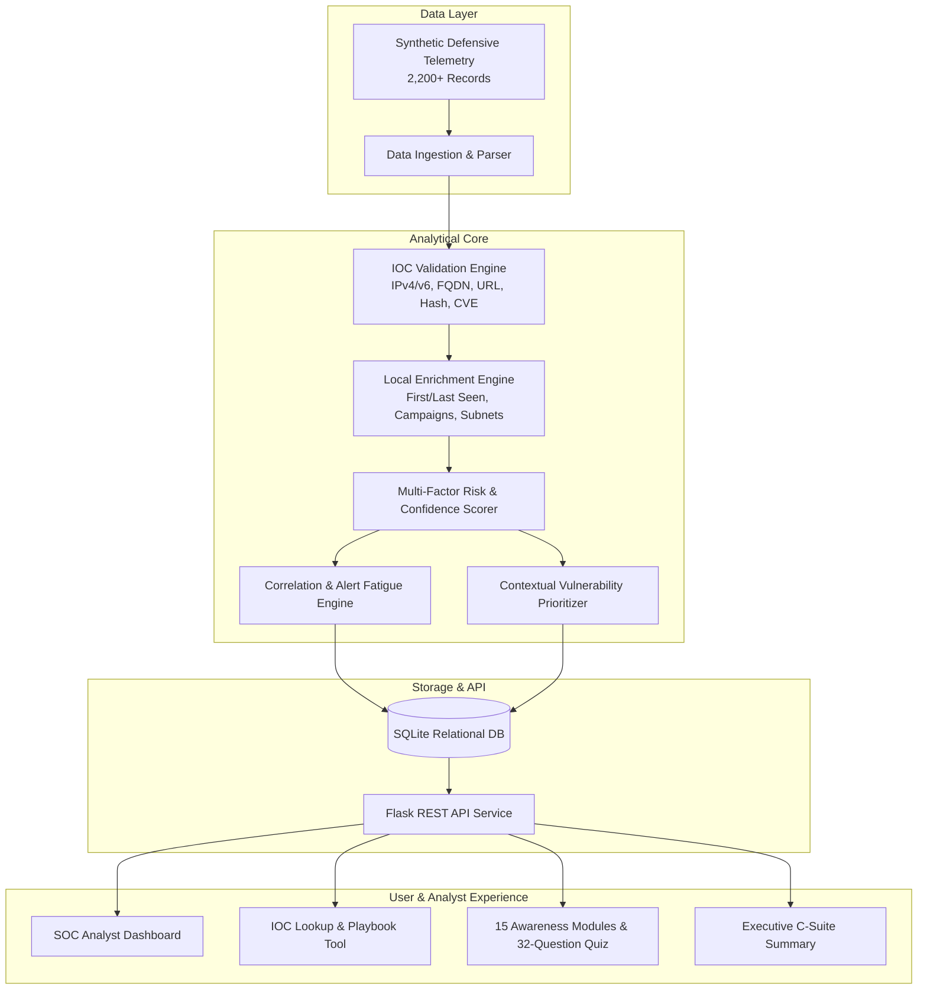

# 📄 Formal Project Report: Cybersecurity Awareness & Threat Intelligence Dashboard

---

## 📑 Executive Summary & Abstract

Modern enterprise cybersecurity operations face a bifurcated challenge: managing an overwhelming volume of technical threat intelligence while simultaneously training end-users to recognize and thwart sophisticated social engineering tactics. Disparate threat feeds and static security awareness PDFs often fail to drive meaningful defensive action.

This project designs, develops, and evaluates the **Cybersecurity Awareness & Threat Intelligence Dashboard**, an integrated defensive platform that ingests, normalizes, validates, enriches, scores, and visualizes cyber threat intelligence while delivering contextual micro-learning modules and interactive assessments to users and SOC analysts.

Operating on a curated, offline-safe dataset of over 2,200 synthetic threat records (compliant with RFC 5737, RFC 3849, and RFC 2606), the system features a **strict syntactic IOC validation engine**, a **multi-factor composite risk scoring formula (0–100)**, an **evidentiary confidence model (0–100)**, an **alert fatigue mitigation algorithm**, and a **contextual vulnerability prioritizer (CVSS + EPSS + CISA KEV + Asset Exposure)**. The system is verified with 37 automated tests and provides complete proof of work for defensive cybersecurity roles.

---

## 1. Introduction & Problem Statement

### 1.1 The Cybersecurity Dilemma
In contemporary Security Operations Centers (SOCs), analysts are bombarded by thousands of Indicators of Compromise (IOCs) daily. Many of these indicators lack actionable context, leading to:
1. **Severe Alert Fatigue**: Repetitive notifications desensitize analysts, causing genuine high-impact intrusions to be overlooked.
2. **Context Deficit**: Isolated IP addresses or domain names do not convey adversary intent (TTPs) or organizational exposure.
3. **Flawed Vulnerability Prioritization**: Treating CVSS base scores as the sole criterion for patching leads to wasted effort on non-exploited internal systems while internet-facing zero-days remain exposed.

### 1.2 The Human Defense Gap
Concurrently, over 80% of successful breaches involve human error (phishing credential theft, MFA fatigue, weak passphrases). Traditional annual compliance training is disconnected from real-time threat telemetry observed by the SOC.

---

## 2. Theoretical Foundations

### 2.1 Cyber Threat Intelligence (CTI) Hierarchy
CTI transforms raw security data into actionable defensive intelligence across four tiers:
- **Strategic CTI**: High-level risk trends for executive leadership and board members.
- **Tactical CTI**: Behavioral adversary Tactics, Techniques, and Procedures (TTPs) via the MITRE ATT&CK framework.
- **Operational CTI**: Details of specific threat actor campaigns and attack timelines.
- **Technical CTI**: Specific atomic indicators (IPs, hashes, URLs, CVEs) utilized for automated firewall and endpoint blocking.

### 2.2 Indicator of Compromise (IOC) vs. Indicator of Attack (IOA)
- **IOC (What happened)**: Forensic forensic artifacts left behind after an adversary action (e.g., file hash, known C2 IP).
- **IOA (How it happened / Behavior in motion)**: Behavioral patterns indicating active adversary intent (e.g., code injection into `lsass.exe`, anomalous PowerShell execution).

> **Core Principle**: An IOC match is an **observation**, not an automatic conviction of compromise.

---

## 3. System Architecture & Data Flow

---

## 4. Core Algorithms & Methodology

### 4.1 Syntactic IOC Validation Routine
Implemented in `backend/services/ioc_validator.py`, the validation engine strictly tests syntax without executing external network queries:
- **IPv4**: Validated via `ipaddress.IPv4Address` parsing; verifies RFC 5737 lab ranges.
- **IPv6**: Validated via `ipaddress.IPv6Address` parsing; verifies RFC 3849 documentation prefixes.
- **FQDN**: Evaluated using regex RFC 1035 compliance and length boundaries (3–253 chars).
- **Cryptographic Hashes**: Hexadecimal regex matching for MD5 (32 chars), SHA-1 (40 chars), and SHA-256 (64 chars).
- **CVE Identifiers**: Standardized `^CVE-\d{4}-\d{4,7}$` format enforcement.

### 4.2 Multi-Factor Risk Calculation Model
Risk score ($R \in [0, 100]$) is computed using a weighted composite formula:
$$R = 0.30 \cdot S_{\text{sev}} + 0.25 \cdot C_{\text{conf}} + 0.15 \cdot R_{\text{recency}} + 0.10 \cdot F_{\text{freq}} + 0.10 \cdot S_{\text{rel}} + 0.10 \cdot C_{\text{context}}$$

- **Severity Weights ($S_{\text{sev}}$)**: Informational (15), Low (35), Medium (55), High (75), Critical (95).
- **Recency Decay ($R_{\text{recency}}$)**: $R = \max(10, 100 - (2 \times \text{Days Since Seen}))$.
- **Observation Frequency ($F_{\text{freq}}$)**: $F = \min(100, \text{Observations} \times 5)$.

### 4.3 Alert Fatigue Reduction & Deduplication
To prevent alert saturation, `alert_engine.py` groups repeated sightings of identical indicators within the observation window:
- Aggregates duplicate occurrences into a single master alert.
- Sums `observation_count` to preserve campaign velocity context.
- Elevates composite risk score proportionally to sighting frequency.

### 4.4 Risk-Based Vulnerability Prioritization
Remediation urgency ($P \in [0, 100]$) is evaluated beyond CVSS base metrics:
$$P = \left(\frac{\text{CVSS}}{10} \times 40\right) + (\text{EPSS} \times 20) + KEV_{\text{boost}} (20) + Exposure_{\text{boost}} (20)$$

This guarantees that actively exploited internet-facing CVEs receive immediate emergency (P1) SLAs (24-48 hours), while isolated test vulnerabilities receive routine maintenance windows (30-90 days).

---

## 5. Security Awareness & Human Defense Engine

The awareness engine (`backend/services/awareness_engine.py`) bridges technical findings with educational intervention:
- **15 Structured Modules**: Phishing, Passwords, MFA, Social Engineering, Safe Browsing, Secure Wi-Fi, Software Patching, Ransomware, Removable Media, Data Exposure, Mobile Security, Remote Work, Cloud Accounts, Incident Reporting, and AI-Enabled Scams.
- **32 Scenario-Based Questions**: Tests practical decision-making across real-world enterprise scenarios.
- **Knowledge Gap Engine**: Dynamically calculates category scores and recommends urgent or refresher training modules for areas scoring below 75%.

---

## 6. Verification & Automated Testing

The platform was verified using a 37-test automated Pytest suite covering:
1. Syntactic validation for all supported indicator formats.
2. Risk, confidence, and source reliability scoring.
3. Local threat enrichment and correlation clustering.
4. Alert generation, deduplication, and status transitions.
5. MITRE ATT&CK taxonomy and metadata retrieval.
6. Vulnerability contextual scoring.
7. Awareness quiz scoring and personalized recommendation logic.
8. REST API response codes and JSON schema integrity.

**Test Result:** `37 passed in 1.17s` (100% pass rate).

---

## 7. Security, Ethical & Defensive Safeguards

1. **Air-Gapped / Offline Safety**: All indicators are stored and analyzed strictly as structured data; no outgoing TCP/HTTP requests are made to suspect domains or IP addresses.
2. **Reserved Infrastructure Compliance**:
   - IPv4: `192.0.2.0/24`, `198.51.100.0/24`, `203.0.113.0/24` (RFC 5737).
   - IPv6: `2001:db8::/32` (RFC 3849).
   - Domains: `example.com`, `example.org`, `example.net`, `*.invalid` (RFC 2606).
3. **Defense-in-Depth**: No offensive payloads, malware binaries, or phishing kits are included.

---

## 8. Limitations & Future Scope

### 8.1 Limitations
- Operates on synthetic and sanitized data rather than live enterprise feeds.
- Correlation engine currently utilizes static heuristic clustering rather than machine learning anomaly detection.

### 8.2 Future Scope
- Integration with standardized STIX 2.1 / TAXII 2.1 threat servers.
- Automated webhook triggers into enterprise SIEMs (Splunk, Microsoft Sentinel) and SOAR platforms.
- Role-Based Access Control (RBAC) with JWT authentication.

---

## 9. Conclusion

The **Cybersecurity Awareness & Threat Intelligence Dashboard** successfully demonstrates an end-to-end, industry-aligned solution to modern threat analysis and human defense. By synthesizing technical indicator correlation with proactive user education, the project proves that effective cybersecurity requires both vigilant analysts and empowered end-users.
